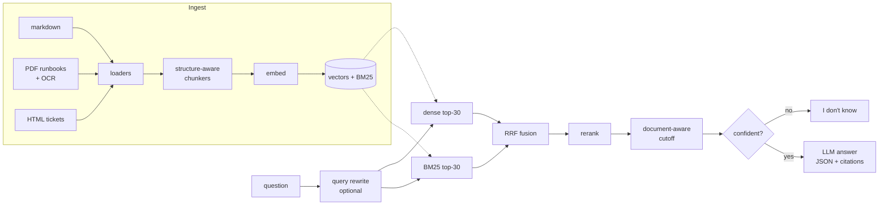

# Helix RAG

[](https://github.com/k-sahi/RAG-Model/actions/workflows/ci.yml)

Retrieval-augmented question answering over the support knowledge base of Helix, a (fictional) B2B workflow automation platform. It ingests 100 documents in three formats, retrieves with hybrid dense + keyword search, and answers with citations, or says it doesn't know.

- **Ingestion:** markdown docs, PDF runbooks (OCR for the 5 scanned ones) and HTML support tickets, each with its own structure-aware chunker
- **Retrieval:** dense + BM25 fused with reciprocal rank fusion, a feature-based reranker, a document-aware cutoff and a confidence floor that refuses off-topic questions
- **Generation:** Claude or OpenAI over REST, JSON output with inline `[n]` citations; an extractive fallback keeps everything working with no API key
- **Evaluation:** context precision and recall on a 50-question test set, LLM-judged faithfulness and correctness, ablation and cross-validated tuning, all run in CI

| Offline retrieval (50 questions) | Value | Target |
|---|---|---|
| Context precision | **0.72** | ≥ 0.60 |
| Context recall | **0.79** | |
| Expected doc in top 3 | **0.96** | |
| Off-topic questions refused | 11 / 15 | |
| In-scope questions wrongly refused | 0 / 50 | |

Full results, ablation and failure analysis: [eval-report.md](eval-report.md).



## Quick start

Requires Python 3.10+. For the scanned PDFs, install Tesseract and Poppler (`brew install tesseract poppler`, or `apt install tesseract-ocr poppler-utils`); without them those 5 files are skipped with a warning.

```bash
git clone https://github.com/k-sahi/RAG-Model.git
cd RAG-Model
python -m venv .venv && source .venv/bin/activate
pip install -r requirements.txt
cp .env.example .env            # optional: add ANTHROPIC_API_KEY or OPENAI_API_KEY

python -m helix_rag ingest      # ~30 s the first time (OCR), ~2 s after that
python -m helix_rag ask "Who has to approve a refund over \$1,000?"
```

The answer comes back with numbered citations, the cited sources and a confidence. To see what retrieval found:

```
$ python -m helix_rag search "Who has to approve a refund over \$1,000?"
confidence 0.727
0.682  runbooks/customer-ops/refund-processing.pdf#1   Approval Required For, Procedure, Issuing The Refund, Documenting
0.679  runbooks/customer-ops/refund-processing.pdf#0   Policy, Exceptions Where Refunds Are Offered, Approval Required For
0.616  runbooks/customer-ops/refund-processing.pdf#2   Documenting, Declining Refunds
```

Other commands:

```bash
python -m helix_rag ask "..." --json --show-context   # structured output with retrieved chunks
python -m helix_rag search "..."                      # retrieval only, with scores
python -m helix_rag chat                              # interactive
```

From Python:

```python
from helix_rag.pipeline import RAGPipeline

rag = RAGPipeline()
answer = rag.ask("Why do my webhook signatures fail to verify?")
answer.answer, answer.sources, answer.abstained
answer.retrieval.chunks          # exactly what the model saw
```

## How it works

### Ingestion

| Format | Loader | Chunking |
|---|---|---|
| Markdown (60) | read as is, title from `# H1` | split on headings with a breadcrumb (`API Errors > Retrying`); tables and code fences are never split; sections under 180 characters merge into the next |
| PDF runbooks (25) | `pypdf`; pages with almost no text are OCR'd with Tesseract at 300 dpi and cached by file hash | split on the runbooks' ALL-CAPS section headings, sections packed up to 900 characters with the last short section repeated as overlap; long sections fall back to a recursive paragraph → sentence → word splitter |
| HTML tickets (15) | BeautifulSoup; keeps speaker, role (Customer / Agent), timestamps, metadata and the resolution | short tickets stay whole, because the fix is usually in the last turn; long ones get a summary chunk (problem + resolution) plus overlapping windows of turns |

Every chunk is indexed with its document title and section path in front of the text, so a 200-character section still says what it is about. The 100 documents become 305 chunks.

### Retrieval

1. **Candidates.** Top 30 by cosine similarity and top 30 by BM25. The tokenizer keeps identifiers whole and split (`X-Helix-Signature`, `HX-1267`, `pg_last_wal_receive_lsn`, `$299`, `429`), which plain word tokenizers destroy.
2. **Fusion.** Reciprocal rank fusion, `score = Σ 1 / (60 + rank)`.
3. **Rerank.** A linear mix of query-term coverage, chunk cosine, heading match, fused rank and similarity to the *whole* source document. Weights came from a grid search and hold up under 2-fold cross-validation (see the report). With `HELIX_RERANKER=llm` the model scores the top 15 instead.
4. **Document-aware cutoff.** Keep documents whose best chunk is within 75% of the best document (at most 3), and up to 3 strong chunks from each. Easy questions get one document's worth of context instead of a padded top-k.
5. **Abstain.** If the corpus has little lexical evidence for the question (term coverage and BM25 strength), nothing is generated and the user gets a clear "not in the knowledge base".

Optional: `HELIX_QUERY_REWRITE=1` lets the LLM add up to two rephrasings in the docs' vocabulary, fused with the original.

### Embeddings and storage

The default embedder is local LSA (TF-IDF + truncated SVD, 256 dimensions): no network, deterministic, about 2 seconds to index everything, and it is what CI runs. `HELIX_EMBEDDER=openai` switches to `text-embedding-3-small` with an on-disk cache keyed by content hash, so re-ingesting unchanged text is free. Vectors live in a numpy array (exact search is instant at this size); set `PINECONE_API_KEY` and `PINECONE_INDEX_HOST` to also write to and query a Pinecone index.

### Generation

The model gets the numbered chunks, each labelled as product doc, runbook or support ticket, and must answer only from them, cite `[n]` for each claim, keep exact values, prefer docs and runbooks over individual tickets, and set `insufficient_context` instead of guessing. Output is JSON (`ask --json`):

```json
{
  "query": "...",
  "answer": "Answer text with inline citations [1] [2].",
  "sources": [{"n": 1, "source": "product-docs/...", "section": "Title > Section", "chunk_id": "product-docs/...#2"}],
  "confidence": "high | medium | low",
  "retrieval_confidence": 0.71,
  "abstained": false,
  "provider": "anthropic | openai | extractive",
  "timings": {"retrieve_ms": 6.1, "generate_ms": 1840.2}
}
```

Provider is picked from whichever key is set (`ANTHROPIC_API_KEY` first). With none, or if the API call fails, an extractive answerer returns the best-matching context sentences with citations.

## Evaluation

```bash
python -m evals.run_eval                       # retrieval metrics, offline, ~2 s
python -m evals.run_eval --judge               # + faithfulness and answer correctness (API key)
python -m evals.ablation                       # what each retrieval stage adds
python -m evals.tune                           # reranker weight search with cross-validation
```

Results go to `evals/results/latest.md` and `latest.json` (per question: retrieved chunks with every score, the answer, cited sources, metrics).

| Metric | How |
|---|---|
| Context precision | share of returned chunks that come from an expected source |
| Context recall | share of expected sources with at least one returned chunk |
| MRR, hit@1, hit@3 | rank of the first expected document among all candidates |
| Key-fact recall | numbers, prices and codes from the reference answer that appear in the generated answer |
| Faithfulness | LLM judge splits the answer into claims and checks each against the retrieved context |
| Answer correctness | LLM judge grades against the reference answer and grading notes (1 / 0.5 / 0) |
| Abstention | 15 off-topic questions in `evals/out_of_scope.json` should be refused; none of the 50 real ones should be |

`test_set.json` is only read by the eval. Nothing from it is used at query time.

## Testing

```bash
python -m unittest discover -s tests -t . -v
```

45 tests: loaders (all 100 documents, OCR text, ticket turns, scanned PDF without OCR), chunkers (breadcrumbs, intact tables and code, overlap), tokenizer and BM25, RRF and the cutoff logic, retrieval on known questions, abstention, generation with a fake LLM (citation mapping, malformed output, API failure fallback), and a quality gate that runs the full eval and fails below the targets. CI runs them on every push with Tesseract installed, then runs the eval; if an `ANTHROPIC_API_KEY` repository secret is set it also runs the judged eval and requires faithfulness ≥ 0.70.

## Configuration

All settings are environment variables (or `.env`); see [.env.example](.env.example).

| Variable | Default | |
|---|---|---|
| `ANTHROPIC_API_KEY` / `OPENAI_API_KEY` | | generation and judging |
| `HELIX_LLM_PROVIDER` | `auto` | `anthropic`, `openai` or `extractive` |
| `ANTHROPIC_MODEL` / `OPENAI_MODEL` | `claude-sonnet-4-5` / `gpt-4o-mini` | |
| `HELIX_EMBEDDER` | `local` | `local` or `openai` |
| `HELIX_RERANKER` | `local` | `local`, `llm` or `none` |
| `HELIX_QUERY_REWRITE` | `0` | `1` to enable |
| `HELIX_CHUNK_SIZE` / `HELIX_CHUNK_OVERLAP` | `900` / `150` | characters |
| `HELIX_TOP_K` / `HELIX_MAX_DOCS` / `HELIX_PER_DOC` | `8` / `3` / `3` | context limits |
| `HELIX_RELATIVE_CUTOFF` / `HELIX_CHUNK_CUTOFF` | `0.75` / `0.7` | document and chunk cutoffs |
| `HELIX_ABSTAIN_THRESHOLD` | `0.36` | retrieval confidence floor |
| `PINECONE_API_KEY` / `PINECONE_INDEX_HOST` | | optional hosted vector index |

## Project structure

```
helix_rag/
  loaders.py      markdown, PDF (+ OCR), HTML ticket loaders
  chunking.py     per-format chunkers
  text.py         tokenizer shared by BM25, embeddings and reranking
  bm25.py         Okapi BM25
  embeddings.py   local LSA and OpenAI embedders
  store.py        numpy and Pinecone vector stores
  index.py        build / save / load the index
  retrieval.py    hybrid search, RRF, rerank, cutoff, abstain
  generation.py   prompt, JSON parsing, citations, extractive fallback
  llm.py          Anthropic and OpenAI REST clients
  pipeline.py     RAGPipeline.ask()
  __main__.py     CLI
evals/            run_eval, judge, metrics, ablation, tune, out_of_scope.json
tests/            unittest suite
corpus/           the Helix knowledge base and test set
docs/design.md    design decisions and trade-offs
eval-report.md    results
```
